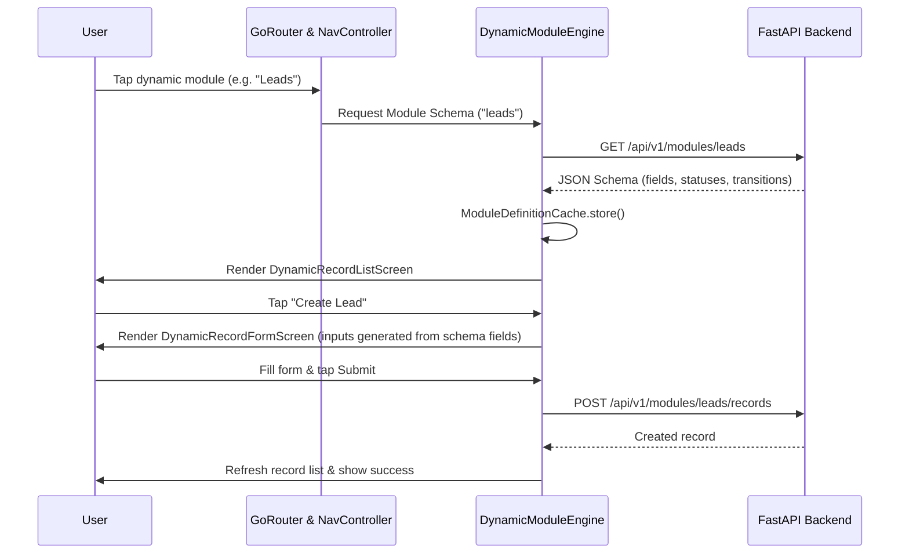

# System Architecture & Technical Design

This document details the software architecture, design patterns, security guarantees, and dynamic engines powering the Right Ads multi-platform application (Android, iOS, Web/Tablet).

---

## 1. Feature-First Clean Architecture

The codebase adheres strictly to Feature-First Clean Architecture:

```
lib/
├── core/                        # Cross-cutting foundational services
│   ├── config/                  # Build-time and server runtime configurations
│   ├── errors/                  # Unified AppFailure types and ErrorMapper
│   ├── l10n/                    # Localization delegates and ARB keys
│   ├── network/                 # Dio provider, token refresh, logging interceptors
│   ├── offline/                 # SyncQueueManager, LocalCacheService, draft storage
│   ├── permissions/             # Permission catalog and PermissionGate
│   ├── theme/                   # Dynamic design tokens, typography, dark/light themes
│   └── widgets/                 # Reusable, accessible design system components
└── features/                    # Independent business domains
    ├── <feature_name>/
    │   ├── presentation/        # Screens, responsive layouts, feature-specific widgets
    │   ├── application/         # Riverpod Notifiers/Controllers, UI state models
    │   ├── domain/              # Freezed entities, business validation rules
    │   └── data/                # Repositories, API endpoints, serialization
```

### Layer Responsibilities & Rules
1. **Presentation Layer**:
   - Contains ONLY UI rendering logic.
   - Zero business rules, validation calculations, direct HTTP requests, or token access.
   - All text comes from `AppLocalizations` (`context.l10n.<key>`) or API responses.
   - Listens to Application controllers via `ref.watch` or `ref.listen`.
2. **Application Layer**:
   - Manages UI state using code-generated Riverpod notifiers (`@riverpod`).
   - Orchestrates domain rules and repository calls.
   - Surfaces immutable state envelopes (`AsyncValue<T>` or `@freezed` state classes).
3. **Domain Layer**:
   - Contains pure business models (`@freezed`), validators, and business logic (e.g. `work_report_rules.dart`, `password_policy_validator.dart`).
   - Zero Flutter UI framework dependencies (`dart:core` only).
4. **Data Layer**:
   - Interacts with backend API endpoints via `Dio`.
   - Maps raw network exceptions into typed `AppFailure` subclasses via `ErrorMapper`.
   - Handles offline database persistence and caching.

---

## 2. Dynamic Module Engine

A core requirement is the ability for the server to dynamically introduce and modify agency workflows without client app recompilation:



### Schema Elements
- **Field Definitions**: Schema supports 18 dynamic field types (Text, Number, Date, Single Select, Multi Select, File, Image, User, Client, Project, GeoPoint).
- **Validation**: Regex matching, min/max length, min/max values, requiredness flags.
- **Workflow State Machine**: Status definitions with configurable colors, sort order, and authorized transitions guarded by server permissions.

---

## 3. Resilience & Security Boundaries

### A. Authentication & Silent Token Refresh
- JWT access tokens (short-lived, 15m) and refresh tokens (long-lived, 7d) are stored exclusively in `FlutterSecureStorage`.
- `TokenRefreshInterceptor` utilizes a single-flight mutex: if 5 concurrent requests encounter a 401, exactly ONE refresh call is executed (`POST /api/v1/auth/refresh`), and all 5 requests retry with rotated credentials.
- **Token Reuse Detection**: If a consumed refresh token is presented, the server revokes the entire session hierarchy; the client detects this and forcibly clears local credentials.

### B. Device Binding & Biometric Lock
- Every request includes the hardware-derived `X-Device-ID` header.
- The server rejects tokens if the device ID mismatches the active session.
- Users can enable local biometric lock (`local_auth`) to protect the app upon background resume.

### C. Attendance Geofencing & Fraud Prevention
- Server coordinates and allowed radius (`geofence_radius_meters`) govern check-in validity.
- Client GPS position is validated for mock locations via `Geolocator.isMocked`.
- **Zero Client Timestamp Trust**: Check-in records rely exclusively on backend server time (`server_timestamp`). Client devices cannot spoof timestamps by modifying system clocks.

---

## 4. Offline Sync & Conflict Resolution

- Critical actions (task comments, work report drafts, attendance check-ins) are queued in `SyncQueueManager` when offline.
- When `connectivityChangesProvider` detects network restoration, the queue flushes FIFO.
- **Conflict Strategy**: On `409 Conflict`, the client recognizes a server-side state precedence, safely drops the stale queued operation, and notifies the user with a non-destructive banner.
